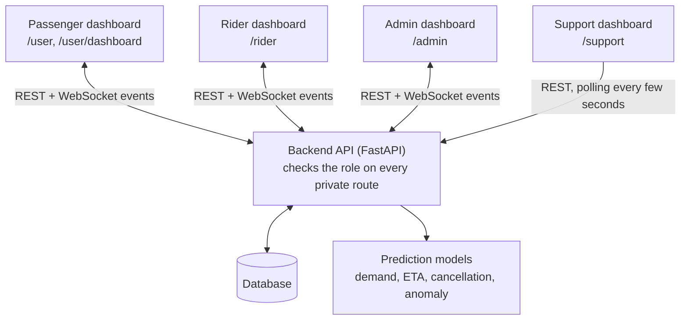
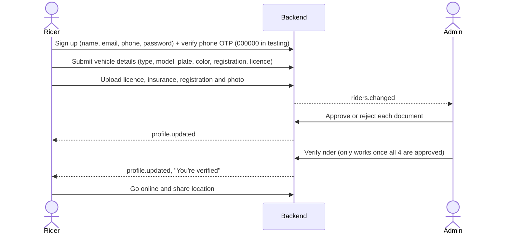
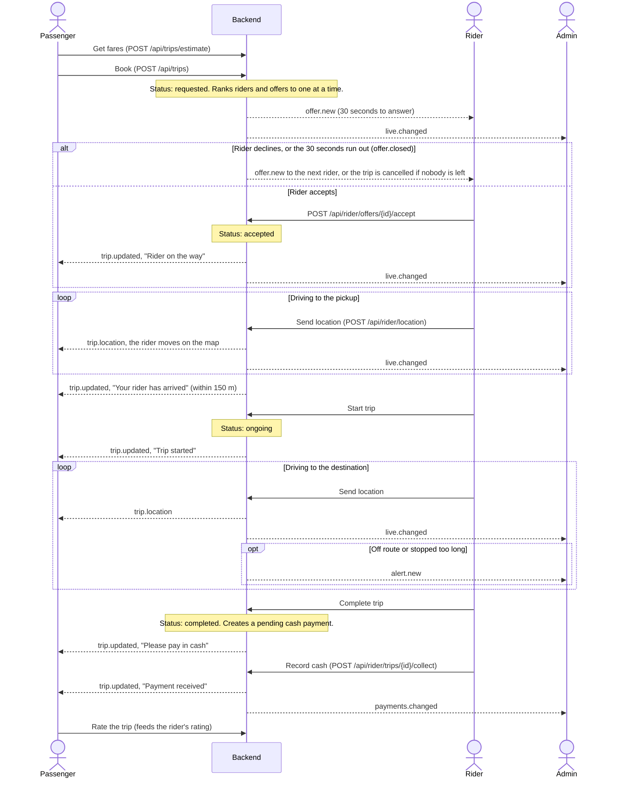
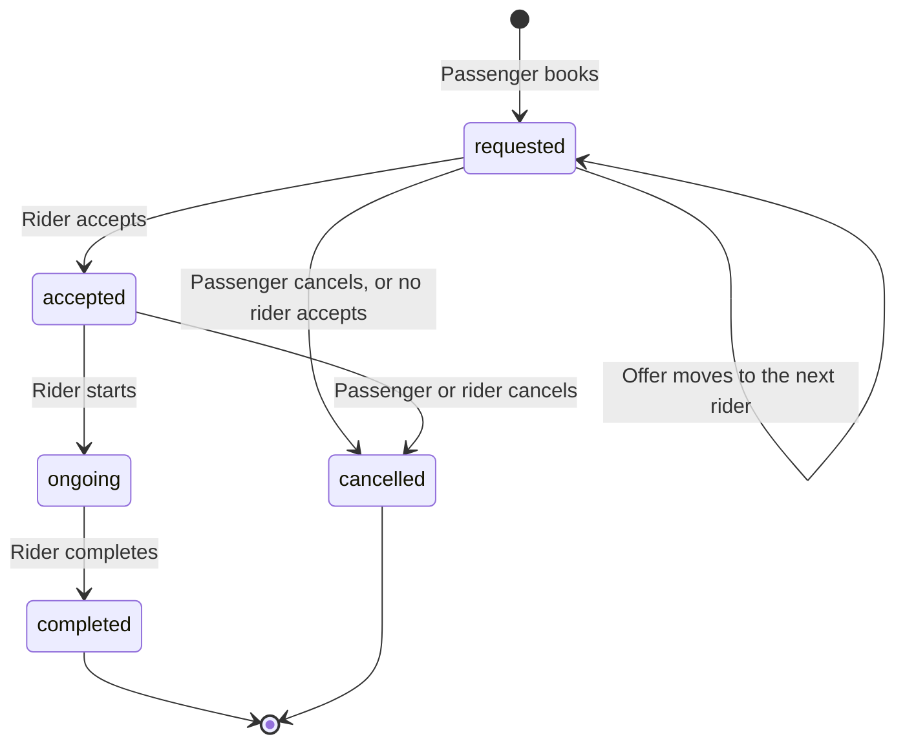

# Cholo team plan

This explains who works on what and how passengers, riders, admins and support agents connect, so that a change in one dashboard doesn't break another. For the wider goals, see the [project proposal](Project%20Proposal.md).

## Who works on what

| Person | Branch | Area |
| --- | --- | --- |
| Tanvir | `Tanvir` | Passenger dashboard |
| Raiyan | `Raiyan` | Rider dashboard |
| Myomi | `Myomii` | Admin dashboard |
| Atia | `Atia` | Support dashboard and deep learning (see [Deep learning](#deep-learning) below) |

Pick up tasks from the [project board](https://github.com/users/TanvirMahmudTushar/projects/8). Issues are labelled `passenger-dashboard`, `rider-dashboard`, `admin-dashboard` and `support-dashboard`. Assign yourself before you start, so two people don't take the same one.

## The one rule: dashboards never talk to each other

All four roles are only connected through the backend. No dashboard calls another dashboard. One role changes data, and the others find out from the database and a real-time event.



Real-time events only mean "something changed, fetch it again". For example, `trip.updated` makes the passenger's page re-fetch `/api/trips/active`. REST is always the source of truth, and pages fall back to polling if the socket drops. Support pages always poll, because events only go to admins.

## How accounts work

| Role | How the account is created | Opens | Can't open |
| --- | --- | --- | --- |
| Passenger (`user`) | Signs up at `/register` | `/user` | `/rider`, `/admin`, `/support` |
| Rider (`rider`) | Signs up at `/register`, then needs admin verification before going online | `/rider` | `/user`, `/admin`, `/support` |
| Admin (`admin`) | No sign-up. The first admin comes from `ADMIN_EMAIL` and `ADMIN_PASSWORD` in `.env` on a database with no admin yet | `/admin` | `/user`, `/rider`, `/support` |
| Support agent (`support`) | Signs up at `/register`, then sees nothing until an admin approves them | `/support` | `/user`, `/rider`, `/admin` |

Everyone uses the same login page. The role is stored on the account, and the backend reads it from the database on every request. The frontend checks are only for a better experience; the backend check is what actually protects data.

### What a support agent can do

Support agents help people with problems, so they can see other people's trips. That's why sign-up alone gives them no access.

- **Can:** see live and recent trips (with names, addresses and rider phone numbers, but not passenger phone numbers), read safety alerts and passenger reports, get an AI summary of an alert, mark alerts as open, reviewed or closed, and keep their own saved replies (admins manage the team replies everyone shares).
- **Can't:** see revenue, stats, pricing, payments, demand forecasts, the rider list or rider documents, or verify or suspend riders.
- **Approval:** an admin approves agents in the **Support** tab of `/admin`, and can remove access there at any time. Access is checked on every request, so removal works immediately.

> **IMPORTANT — Testing OTP Default (`000000`):** Phone OTP verification during `/register` (`POST /api/auth/otp/request`, `POST /api/auth/otp/verify`, and `POST /api/auth/register`) currently uses a hardcoded testing default `Settings.default_test_otp = "000000"` in `backend/app/config.py`. **Future work MUST replace this with a real SMS/OTP provider (with expiring single-use codes and rate limiting) before any production deployment.**

## How a rider gets ready to take trips

A passenger can only be matched with a rider after an admin has approved that rider.



A rider is offered a trip only if all of these are true:

- verified and online
- has the vehicle type the passenger asked for
- within 8 km of the pickup
- not already on a trip
- has sent a location in the last 2 minutes (a closed tab stops offers)

## How a ride connects all three roles



### Trip statuses

All three dashboards depend on these. Change them only after talking to the whole team.



A trip can't be cancelled once it's `ongoing`. A rider can't go offline during a trip, and an admin can't suspend a rider who is on one.

## What each role changes for the others

| When this happens | Who sees it | Event |
| --- | --- | --- |
| Passenger books | The best-ranked rider gets an offer; admin's live view updates | `offer.new`, `live.changed` |
| Passenger cancels | Rider is told; an open offer closes; admin's live view updates | `trip.updated`, `offer.closed`, `live.changed` |
| Passenger raises an SOS or reports a trip | Admin gets a safety alert | `alert.new` |
| Passenger rates a trip | Rider's rating changes | None; it shows on the next fetch |
| Rider accepts, starts, completes or cancels | Passenger is told; admin's live view updates | `trip.updated`, `live.changed` |
| Rider sends a location | Passenger's map moves; admin's live map updates | `trip.location`, `live.changed` |
| Rider goes off route or stops too long during a trip | Admin gets a safety alert | `alert.new` |
| Rider records cash | Passenger is told; admin's payments update | `trip.updated`, `payments.changed` |
| Rider uploads a document | Admin's review queue updates | `riders.changed` |
| Admin reviews documents, verifies or suspends a rider | Rider is told | `profile.updated` |
| Admin changes pricing rules | New fares and commission apply to new bookings | None; it shows on the next quote |
| Admin records a settlement | Rider's commission owed goes down | `earnings.updated` |
| Support agent signs up | Admin's Support tab updates and shows a notice | `support.changed` |
| Admin approves an agent or removes access | Agent's page opens or closes within a few seconds | `support.changed` for admins; the agent's page polls |
| Support agent marks an alert reviewed or closed | Admin's Safety tab shows the new status | None; it shows on the next fetch |

## Where the code lives

| Area | Frontend | Backend (`backend/app/`) |
| --- | --- | --- |
| Passenger | `src/app/user/`, `src/components/passenger/` | `routers/trips.py`, `routers/passenger.py`, `routers/assistant.py` |
| Rider | `src/app/rider/`, `src/components/rider/` | `routers/rider.py`, `routers/documents.py`, `routers/payments.py` |
| Admin | `src/app/admin/`, `src/components/admin/` | `routers/admin.py`, `routers/documents.py`, `routers/payments.py` |
| Support | `src/app/support/`, plus `src/components/admin/alerts-tab.tsx` and `live-trips.tsx`, shared with admin | `routers/admin.py` (routes using `Staff`) |
| Prediction models | Shown in the admin overview and demand tabs | `services/predictors.py` (`registry`), `services/demand.py` |

The frontend paths are inside `frontend/`.

### Shared files: tell the team before changing these

These affect more than one dashboard, and they're where merge conflicts are most likely:

- **Trip rules:** `services/trips.py`, `services/matching.py`, `services/pricing.py`, `services/payments.py`, `services/alerts.py`
- **Data shapes:** `models.py`, `schemas.py`, and `frontend/src/lib/types.ts`
- **Login and roles:** `security.py`, `routers/auth.py`, `frontend/src/lib/session.ts`
- **Real-time:** `realtime.py`, `frontend/src/lib/realtime.tsx`
- **Shared UI:** `frontend/src/components/app-shell.tsx`, `ride-bits.tsx`, `trip-history.tsx`, `map/`, `ui/`, `globals.css`

## Rules for cross-dashboard changes

1. **Protect every new route.** Use `Passenger`, `CurrentRider`, `Admin`, `Staff` or `CurrentUser` from `security.py`. `Staff` means admins and approved support agents, and giving a route to support is a privacy decision: add it to `SUPPORT_ROUTES` in `tests/test_auth.py` and tell the team. `tests/test_auth.py` fails if a route has no login check. Add a passenger, rider or admin route under its existing URL prefix, and that test also checks the other roles are refused.
2. **Check ownership.** Passing the role check isn't enough: confirm the trip or document belongs to this user, like `_own_trip` and `_assigned_trip` do.
3. **Don't rename or remove API fields on your own.** Another dashboard may read them. Adding a field is safe.
4. **New live data needs both sides.** Call `emit(...)` in the backend, and add the event to `EVENT_KEYS` in `frontend/src/lib/realtime.tsx`, or pages won't refresh.
5. **New database columns must be nullable** so existing databases update on restart. See `create_schema` in `db.py`.
6. **Keep trip logic in `services/trips.py`.** The routers and the simulator all use it, so every path follows the same rules.
7. **Replace a prediction model through `registry`,** behind the same interface, so matching, pricing and alerts don't need to change.

## Deep learning

Every model is currently a simple baseline in `backend/app/services/predictors.py`. A trained model replaces its baseline through `registry`, keeping the same method, so the dashboards and services don't need to change. Each model has to beat its baseline; the metrics are in the proposal's [evaluation plan](Project%20Proposal.md#evaluation-plan).

| Order | Model | Method to keep | Baseline to beat | Data to train on |
| --- | --- | --- | --- | --- |
| 1 (core) | Demand forecasting | `forecast(zone_id, vehicle_type, when, raining)` | `historical-average-v1` | NYC TLC, Chicago, Open-Meteo |
| 2 (core) | ETA prediction | `predict_eta(distance_km, vehicle_type, when)` | `distance-over-speed-v1` | NYC TLC, Chicago, OpenStreetMap; Porto for real routes |
| 3 (stretch) | Cancellation prediction | `cancel_probability(pickup_km, trip_km, rider_cancel_rate, peak)` | `logistic-heuristic-v1` | No dataset yet (see below) |
| 4 (stretch) | Anomaly detection | `score(distance_from_route_km)` | `route-threshold-v1` | Trip simulator; Porto for normal trips |

A new model may need more inputs than these methods take. If so, tell the team before changing them, because matching, pricing and alerts all call them.

### Datasets

| Dataset | What it has | Size | Licence | Links |
| --- | --- | --- | --- | --- |
| NYC TLC trip records | Monthly trips with pickup and drop-off time and taxi zone, distance and fare; checked up to September 2026 | Yellow: about 48 MB a month. High-volume (Uber, Lyft): about 451 MB a month | Public; check the data page | [Data page](https://www.nyc.gov/site/tlc/about/tlc-trip-record-data.page), [yellow January 2024](https://d37ci6vzurychx.cloudfront.net/trip-data/yellow_tripdata_2024-01.parquet), [green January 2024](https://d37ci6vzurychx.cloudfront.net/trip-data/green_tripdata_2024-01.parquet), [high-volume January 2024](https://d37ci6vzurychx.cloudfront.net/trip-data/fhvhv_tripdata_2024-01.parquet) |
| NYC taxi zones | Zone names and map shapes, for building the zone graph | Under 2 MB | Public; check the data page | [Lookup CSV](https://d37ci6vzurychx.cloudfront.net/misc/taxi_zone_lookup.csv), [shapefile](https://d37ci6vzurychx.cloudfront.net/misc/taxi_zones.zip), [column guide](https://www.nyc.gov/assets/tlc/downloads/pdf/data_dictionary_trip_records_yellow.pdf) |
| Chicago taxi trips | A second city for testing: January 2024 to October 2026, with duration, miles, fare and approximate pickup and drop-off points. Times are rounded to 15 minutes | Large; filter by date through the API | See the city's terms of use | [Data page](https://data.cityofchicago.org/d/ajtu-isnz), [CSV API](https://data.cityofchicago.org/resource/ajtu-isnz.csv) |
| OpenStreetMap, Bangladesh | Road network for the ETA graph and for local testing | 340 MB | ODbL 1.0 | [Download page](https://download.geofabrik.de/asia/bangladesh.html), [direct file](https://download.geofabrik.de/asia/bangladesh-latest.osm.pbf) |
| Open-Meteo weather | Hourly temperature and rain for any city and date | Small API responses | Check the [terms](https://open-meteo.com/en/terms) before the final report | [API guide](https://open-meteo.com/en/docs/historical-weather-api), [Dhaka example](https://archive-api.open-meteo.com/v1/archive?latitude=23.81&longitude=90.41&start_date=2024-01-01&end_date=2024-01-01&hourly=temperature_2m,precipitation) |
| Porto taxi trajectories (optional, not in the proposal) | Full GPS traces from 442 taxis in Porto: the only dataset here with real routes | 509 MB | CC BY 4.0 | [Data page](https://archive.ics.uci.edu/dataset/339/taxi+service+trajectory+prediction+challenge+ecml+pkdd+2015) |

To get another NYC month, change the type and date in this address. The types are `yellow`, `green`, `fhv` and `fhvhv`:

```
https://d37ci6vzurychx.cloudfront.net/trip-data/{type}_tripdata_{YYYY}-{MM}.parquet
```

### Limits of the data

- **Cancellation has no real data yet.** None of these datasets records rider cancellations. The trip simulator doesn't make riders decline or cancel either, and the seed data's cancellations are random. Decide how to generate believable behaviour, such as adding it to the simulator, before training this model, and say in the report that the data is simulated.
- **NYC and Chicago don't include routes.** They only give where a trip started and ended, as a zone or an approximate point. A road-level ETA model needs Porto's traces or routes built on OpenStreetMap.
- **Anomaly labels come from the simulator.** `services/simulator.py` adds detours and long stops to 15% of trips by default, so those trips can be used for testing.
- **Don't train on the seed trips.** They exist so the app can run, and they contain rules we invented.
- **The training cities aren't Dhaka.** Report how well the models transfer as a limitation, as the proposal says.

### Working with the data

- Never commit datasets or trained models. GitHub rejects files over 100 MB, and a large file stays in the history even after you delete it. `.gitignore` already covers `*.pt`, `*.pth`, `*.onnx` and `*.ckpt`, but not `*.parquet`, `*.pbf` or `*.csv`, so add those before you download anything.
- Atia and Myomi should agree how model results appear in the admin dashboard. It already shows the 7-day ETA error, and issue #20 covers model evaluation.

## Run it and test every role

**Backend**, from `backend/`:

```
python -m venv .venv
.venv\Scripts\activate
pip install -r requirements-dev.txt
uvicorn app.main:app --reload --port 8000
```

Copy `.env.example` to `.env` in the project root, then set `JWT_SECRET`, `ADMIN_EMAIL` and `ADMIN_PASSWORD`. Never commit `.env`.

**Frontend**, from `frontend/`:

```
npm install
npm run dev
```

**Tests**, from `backend/`: `python -m pytest`. Before opening a PR, also run `npx tsc --noEmit` and `npm run lint` in `frontend/`.

**Which mode to use**

- **`DEMO_MODE=true`** is the quickest. It adds demo accounts with one-click buttons on the login page, simulated riders, 14 days of fake trips and the trip simulator. It writes this data to your local database, so use a separate database if you want to keep yours clean.
- **`DEMO_MODE=false`** starts with no riders, so booking fails with "No riders available" until a real rider is verified and online.

**Testing a full ride by yourself**

The login is stored per browser, so two tabs in the same browser share one account. Use a different browser or profile for each role, such as a normal window, an incognito window and a second browser.

1. **Rider:** sign up and upload the three documents.
2. **Admin:** approve the documents and verify the rider.
3. **Rider:** go online. If your browser can't get GPS, turn on manual position and set it on the map.
4. **Passenger:** book the same vehicle type, with a pickup within 8 km of the rider.
5. **Rider:** accept, start and complete the trip, then record the cash.
6. **Admin:** watch the live map, alerts and payments as it happens.

To test support, sign up on the **Support staff** tab, then approve the account as admin in the **Support** tab. Demo mode also has an approved agent on the login page.

## Deployment

The live app runs on free plans, and all three accounts belong to Tanvir. Ask him if you need a setting changed or a deploy run.

| Part | Where | Address |
| --- | --- | --- |
| Frontend | Vercel | https://heycholo.vercel.app |
| Backend | Render, service `cholo-backend` | https://cholo-backend-tl67.onrender.com (health check: `/api/health`) |
| Database | Supabase (PostgreSQL), through the Session pooler | Private; never share the connection string |

Your local setup doesn't use any of these. It keeps running on `localhost` with its own SQLite database, so nothing you do locally touches live data.

### How the parts connect

| Setting | Where it's set | What it does |
| --- | --- | --- |
| `NEXT_PUBLIC_API_URL` | Vercel | Tells the frontend where the backend is. It's built into the site, so redeploy Vercel after changing it. Without it, the site tries `http://localhost:8000` |
| `CORS_ORIGINS` | `render.yaml` | Lists the websites allowed to call the backend from a browser. Only `heycholo.vercel.app` is allowed, so Vercel preview links can't log in |
| `DATABASE_URL` | Render | Connects the backend to Supabase. Use the Session pooler address, because the direct `db.*.supabase.co` address is IPv6 only |
| `JWT_SECRET` | Render, generated by Render | Signs login tokens. Changing it logs everyone out |
| `ADMIN_EMAIL`, `ADMIN_PASSWORD` | Render | Create the first admin, only if the database has no admin yet |
| `GROQ_API_KEY` | Render | Turns on AI text. Without it, the app uses fixed text |

### Deploying a change

1. Merge your PR into `main`.
2. **Backend:** Render doesn't deploy automatically yet, so Tanvir has to run **Manual Deploy** on `cholo-backend`.
3. **Frontend:** check that the new version appears on the live site. If it doesn't, ask Tanvir to redeploy it on Vercel.
4. Open `/api/health` on the backend and test your change on the live site.

The tables are created on startup, and new nullable columns are added automatically. A change to an existing column isn't applied, so tell the team first and plan it by hand.

### Test against Postgres before merging database changes

Local work uses SQLite, but the live database is Postgres, which is stricter. If you change models or queries, run the tests on an empty local Postgres database, never the live one:

```
$env:TEST_DATABASE_URL = "postgresql://postgres@127.0.0.1:5432/cholo_test"
python -m pytest
```

That example is for PowerShell, and assumes a local Postgres with a database called `cholo_test`. Add your local password to the address if yours needs one.

### Limits of the free plans

- **Rider documents don't last.** Render's free plan has no permanent disk, so uploaded licences and photos are lost on every restart or redeploy. Trips and accounts are safe in Supabase. This has to be fixed before real riders use the app.
- **The first request can be slow.** The backend sleeps after about 15 minutes idle, and waking it can take about a minute. Open the site a minute or two before a demo.
- **Booking needs a real rider.** The live database has no demo data, so a passenger can't book until a rider has signed up, been approved by an admin and gone online.

### Secrets

- Never put a password, key or connection string in the code, `render.yaml`, an issue, a PR or the group chat. This repo is public, and anything committed stays in its history.
- Set secrets only in the Render or Vercel dashboard. `render.yaml` lists their names, not their values.
- If a secret is exposed anywhere, tell Tanvir straight away so it can be changed.

## Git workflow

Work on your own branch, and keep up with `main` so conflicts stay small:

```
git switch your-branch
git pull origin main
```

Run that before you start work, before you open a PR, and right after any PR is merged. Then:

1. Commit to your branch and push it.
2. Open a PR into `main`.
3. Merge with **Create a merge commit**, not **Squash**. Squashing leaves your branch with a different history from `main`, which causes conflicts later.
4. Run `git pull origin main` on your branch again.

Keep PRs small, and say in the group chat before you edit a shared file.
