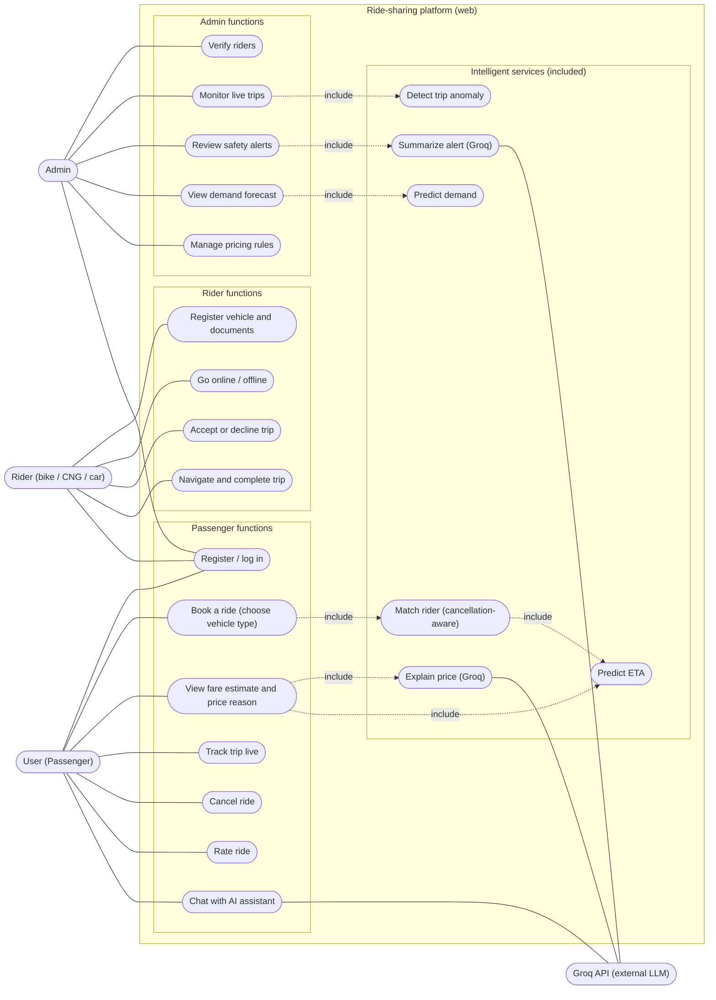
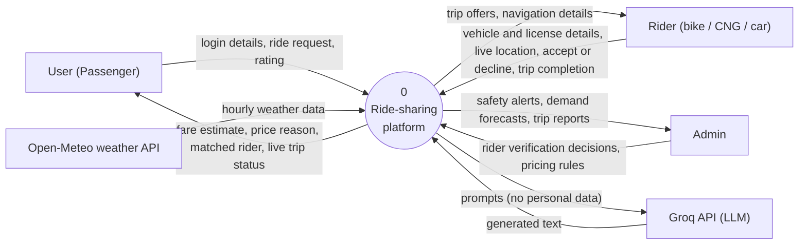
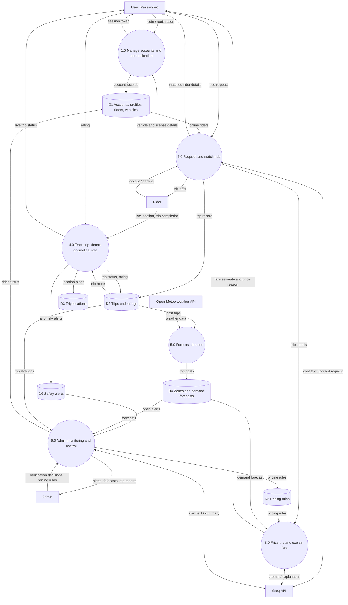
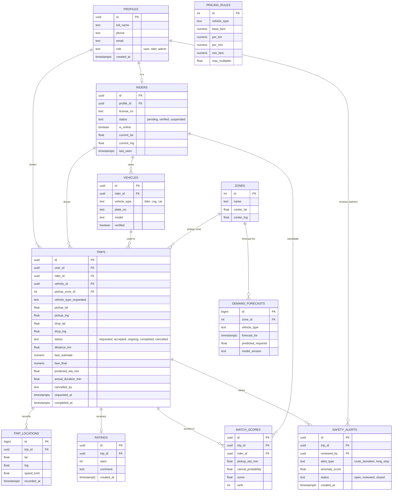
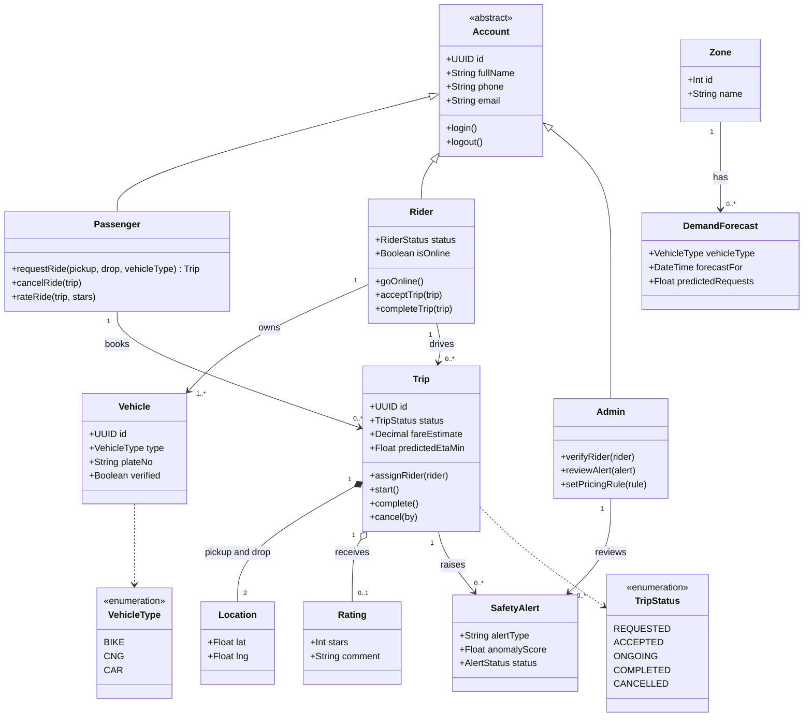
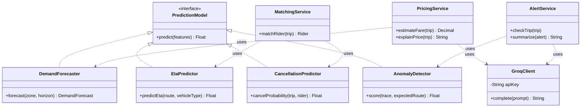

 # Project Proposal: Deep Learning–Driven Ride-Sharing App

## Abstract

This project will build a working web-based ride-sharing platform that uses deep learning to cut passenger wait times, reduce driver cancellations and make pricing more predictable. Existing platforms such as Uber and Pathao still struggle with surge pricing, last-minute cancellations, inaccurate arrival estimates and weak safety monitoring, and these problems are sharper in South Asian cities with dense traffic and poor map data.

The system pairs a conventional web application (a user portal for passengers, a rider portal for bike, CNG and car riders, an admin dashboard and a backend API) with four learning components: spatio-temporal demand forecasting, graph-based ETA prediction, cancellation-aware matching and trip anomaly detection for safety. Models will be trained first on public trip datasets, such as the NYC Taxi & Limousine Commission records, and then tested on simulated local trips. Each model will be compared against simple baselines so the gain from deep learning is measured, not assumed.

## Background and problem statement

Ride-sharing is now a daily transport option in Bangladeshi cities, but passengers and drivers both report recurring problems that current apps handle with simple rules rather than learned predictions.

| Who is affected | Problem | Why current apps fall short |
| --- | --- | --- |
| Passengers | Long, unpredictable waits | Drivers are not positioned ahead of demand peaks |
| Passengers | Sudden surge pricing | Prices react to shortages after they happen, with no explanation |
| Passengers | Drivers cancel after accepting | Matching ignores how likely a driver is to cancel a given trip |
| Passengers | Inaccurate arrival times | Estimates rely on distance and map speeds that miss local traffic |
| Passengers and drivers | Safety incidents go unnoticed | Few automatic checks for route deviation or unusual stops |
| Drivers | Idle time between trips | No guidance on where demand will appear next |

Local conditions make these harder: narrow and unnamed streets, mixed traffic of cars, motorbikes and CNGs, and patchy mobile internet. The research question is whether deep learning models can measurably improve wait time, cancellation rate and ETA accuracy over the rule-based methods commonly used today.

## Objectives

The main objective is a working prototype in which deep learning models drive dispatch, ETA and safety decisions, with their benefit measured against baselines.

1. Build a functional web platform with a user portal, a rider portal (separate rider types for bikes, CNGs and cars), an admin dashboard and a backend API supporting booking, live tracking, matching and trip completion.
2. Develop a demand forecasting model that predicts ride requests per zone for the next 15–60 minutes.
3. Develop an ETA prediction model that outperforms distance-based estimates.
4. Develop a cancellation prediction model and use it in a matching algorithm that lowers expected cancellations.
5. Develop a trip anomaly detector that flags route deviations and unusual stops for safety review.
6. Evaluate every model against a non-deep-learning baseline and report the results.

Secondary objectives, if time allows: transparent price explanations shown to passengers, and lightweight, mobile-friendly pages that work on slow connections.

## Proposed system

The system is one Next.js web app with three role-based portals (user, rider and admin), a FastAPI backend and a separate deep learning layer the backend calls for predictions.

Three roles use the platform, and riders are registered by vehicle type (bike, CNG or car), so a trip request is only matched to riders of the requested vehicle type.

| Role | Who | Main actions |
| --- | --- | --- |
| User | Passenger | Book a ride, choose a vehicle type, track the trip, see the reason for the price, rate the ride |
| Rider | Driver of a bike, CNG or car | Register a vehicle, go online, accept or decline trips, complete trips |
| Admin | Platform operator | Verify riders, monitor live trips and safety alerts, view demand forecasts |

Architecture (portals talk only to the backend, which calls four learning models):

```
 User portal            Rider portal             Admin dashboard
 (passengers)           (bike, CNG, car)         (monitor trips, alerts)
      \                       |                        /
       \______________________|_______________________/
                              |
              Backend API (FastAPI on Render)
        booking, matching, pricing, live tracking, trip records
                    /                          \
   Data and maps                         Deep learning layer (PyTorch)
   - Supabase: PostgreSQL + PostGIS,     - Demand forecasting
     Auth, realtime updates              - ETA prediction
   - OpenStreetMap + OSRM                - Cancellation model (feeds matching)
                                         - Anomaly detection (route deviations)
```

Users, riders and admins never call the models directly: the backend asks the deep learning layer for forecasts, ETAs, match scores and anomaly checks, then sends results to the portals in real time.

## Deep learning components

Four models form the intelligence layer; each serves one problem from the problem statement and is exposed to the backend as an API.

| Component | Problem it addresses | Inputs | Proposed model | Output |
| --- | --- | --- | --- | --- |
| Demand forecasting | Long waits, driver idle time, surge pricing | Past requests per zone, time of day, day of week, weather, holidays | Spatio-temporal graph neural network (e.g. ST-GCN) or LSTM over a zone grid | Expected requests per zone, next 15–60 min |
| ETA prediction | Inaccurate arrival times | Route segments, time, historical speeds, distance, vehicle type | Graph neural network over the road network, or a Transformer over route sequences | Predicted travel time in minutes |
| Cancellation-aware matching | Drivers cancelling after accepting | Driver history, pickup distance, trip length, destination zone, time, vehicle type | Feed-forward network predicting cancellation probability, used inside the matching score | Ranked driver list per request |
| Trip anomaly detection | Unnoticed safety incidents | Live GPS trace versus expected route, stop durations, speed | LSTM autoencoder trained on normal trips | Anomaly score and alert |

Demand forecasts also feed a smoother pricing rule, so price changes can be shown to passengers with a short reason (for example, high expected demand in the area).

## System design diagrams

### Use case diagram



Passengers, riders and admins each have their own functions; the Groq API acts as an external actor for price explanations, alert summaries and the assistant.

### Data flow diagrams

The Level 0 diagram shows the platform as one process and the outside parties it exchanges data with.



Level 1 splits the platform into six processes (accounts, request and matching, pricing, trip tracking, demand forecasting, admin monitoring) and six data stores.



### Entity-relationship diagram



The database is PostgreSQL with PostGIS on Supabase. Vehicle type on the `VEHICLES` table drives matching, and model outputs are stored in `MATCH_SCORES` and `DEMAND_FORECASTS`.

### Class diagrams

Domain classes (accounts, vehicles, trips, locations, ratings, alerts, zones):



Service and model classes (the four predictors implement one `PredictionModel` interface; `GroqClient` wraps the API):



## Methodology, datasets and tech stack

The work follows an iterative approach: build the core app first, then add one model at a time, training on public data and validating in a simulated city environment.

**Datasets and data sources.** There is no public Bangladeshi ride-hailing trip dataset, so models are trained on public data from other cities and then tested on simulated local trips. All sources below were checked for availability.

| Source | Used for | Access |
| --- | --- | --- |
| NYC TLC Trip Record Data (Parquet; yellow, green, FHV and high-volume FHV) | Demand forecasting, ETA | `https://d37ci6vzurychx.cloudfront.net/trip-data/{type}_tripdata_{YYYY}-{MM}.parquet` |
| Chicago Taxi Trips (2024 onward; times rounded to 15 minutes) | Second city to test generalisation | `https://data.cityofchicago.org/d/ajtu-isnz` |
| OpenStreetMap, Bangladesh extract (Geofabrik, about 339 MB, ODbL 1.0) | Road graph, routing, simulator map | `https://download.geofabrik.de/asia/bangladesh-latest.osm.pbf` |
| Open-Meteo Historical Weather API (hourly temperature and precipitation) | Weather input to demand model | `https://archive-api.open-meteo.com/v1/archive` |
| Own trip simulator on the Bangladeshi road map | Matching, cancellation and anomaly experiments | Built in this project |

The Pathao food dataset on GitHub (323,139 records) has no coordinates or timestamps, so it cannot be used for trip modelling. Chicago's licence is not stated on its portal page and Open-Meteo's terms for non-commercial use should be confirmed before the final report.

**Groq API (language-model services).** Groq provides an OpenAI-compatible API (base URL `https://api.groq.com/openai/v1`, key stored in the `GROQ_API_KEY` environment variable on the backend only). It is used for text tasks, not for the core predictions, which stay in the four trained models.

| Use | Model | Purpose |
| --- | --- | --- |
| Price explanation | `llama-3.1-8b-instant` | Turns the pricing inputs (demand forecast, time, weather) into a one-sentence reason shown to the passenger |
| Safety alert summary | `llama-3.3-70b-versatile` | Summarises an anomaly score, route deviation and stop duration for the admin |
| Passenger assistant | `openai/gpt-oss-20b` (131,072-token context) | Answers questions about a trip and helps fill a booking |

Free-tier limits are low (the documentation lists about 30 requests per minute and 1,000 per day for the gpt-oss models), so the backend caches repeated explanations, sends no personal data in prompts and falls back to a fixed template if Groq is unavailable. Model names and limits change, so they should be checked at `console.groq.com` before use. Unsupported parameters include `logprobs`, `logit_bias` and `n` greater than 1.

**Tech stack.**

| Layer | Tools |
| --- | --- |
| Frontend (user, rider and admin portals) | Next.js (React), one web app with role-based routes |
| Backend API | FastAPI (Python) |
| Database, authentication, real-time | Supabase (PostgreSQL with PostGIS, Auth, Realtime for live locations) |
| Maps and routing | OpenStreetMap, Leaflet (map display), OSRM (routing) |
| Deep learning | PyTorch, PyTorch Geometric |
| Language model | Groq API (Llama and gpt-oss models) |
| Model serving | Models served through the FastAPI backend |
| Hosting | Vercel (frontend), Render (backend) |
| Version control | GitHub |

## Evaluation plan

Each model succeeds only if it beats a simpler baseline on held-out data; system-level gains are measured in the trip simulator.

| Component | Baseline | Metrics |
| --- | --- | --- |
| Demand forecasting | Historical average per zone and hour; gradient boosting (XGBoost) | MAE, RMSE |
| ETA prediction | Distance ÷ average speed; OSRM estimate | MAE in minutes, MAPE |
| Cancellation prediction | Logistic regression | ROC-AUC, F1 |
| Matching (system level) | Nearest available driver | Average passenger wait time, cancellation rate, driver idle time |
| Anomaly detection | Fixed distance-from-route threshold | Precision, recall on injected anomalous trips |

The app itself will be tested for end-to-end booking, live tracking and response time under simulated load.

## Timeline

The project fits one 16-week semester, with a checkpoint at week 10 that guarantees a complete minimum project.

| Phase | Weeks | Work |
| --- | --- | --- |
| Research | 1–2 | Literature review, requirements, dataset preparation |
| Core app | 3–6 | Web portals and authentication, backend, maps, live tracking |
| Core models | 7–10 | Demand forecasting, ETA prediction |
| **Gate: minimum scope met (end of week 10)** | | Core app plus demand and ETA models working |
| Stretch models | 11–13 | Cancellation model, anomaly detection |
| Evaluation | 14–16 | Baseline tests, report, demo |

If the week-10 gate slips, the stretch models are dropped and the remaining time goes to evaluation and the report.

## Expected outcomes, risks and limitations

The project will deliver a working prototype, four trained models and a written comparison showing where deep learning helps and where simpler methods are enough.

**Deliverables.**

- Web platform with user portal, rider portal, admin dashboard and backend API, deployed on Vercel and Render (source code on GitHub).
- Trained demand, ETA, cancellation and anomaly models with evaluation results.
- A trip simulator for testing dispatch strategies.
- A final report and live demonstration.

**Risks and mitigation.**

| Risk | Mitigation |
| --- | --- |
| No real local trip data | Train on public datasets; validate on simulated trips over a real Bangladeshi road map |
| Models trained on New York data may not transfer to Bangladeshi traffic | Report this as a limitation; test transfer on a second city (Chicago); design models to retrain on local data later |
| Deep learning may not beat simpler baselines on small data | Treat this as a valid finding and report it honestly |
| Scope too large for one semester | Core app and two models (demand, ETA) are the minimum; matching and anomaly detection are stretch goals |
| Free-tier hosting limits (Render sleeps when idle and has limited memory) | Train offline (laptop or Colab), serve small exported models such as ONNX, and warm the server before demos |

The prototype will not process real payments or carry real passengers; safety and pricing features are demonstrated in simulation only.

## Conclusion

This project tests a practical question: whether deep learning can make ride-sharing faster, fairer and safer in conditions like Bangladesh's, compared with the simple rules most apps use. It combines full-stack app development with applied deep learning and honest evaluation, and its results could guide local ride-sharing services. I would welcome your guidance on scope and supervision.
